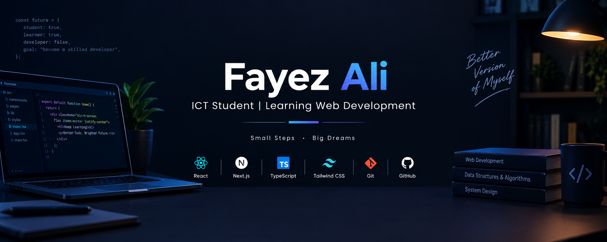

  

# Hi, I'm Fayez Ali 👋

### B.Sc. Engineering Student in ICT at MBSTU

I'm an ICT student at Mawlana Bhashani Science and Technology University (MBSTU), currently learning web development and exploring modern technologies.

## 👨‍💻 About Me

I'm a B.Sc. Engineering student in Information and Communication Technology (ICT) at Mawlana Bhashani Science and Technology University (MBSTU).

I'm currently learning web development and building projects to improve my programming and development skills. I enjoy exploring new technologies, solving problems, and turning ideas into working projects.

### 🚀 Currently

- 🎓 Studying ICT at MBSTU
- 🌱 Learning React, Next.js, TypeScript and Tailwind CSS
- 💻 Building projects to improve my practical skills
- 📚 Practicing Data Structures & Algorithms
- 🔧 Learning Git and GitHub
## 🛠️ Skills & Technologies

### 🎨 Frontend Development

  

### ⚙️ Backend Development

  

  

### 💻 Programming Languages

  

### 🔧 Tools & Platforms

  

  
  
  

## 📌 Current Focus

- 🚀 Building projects with React, Next.js and TypeScript
- 🎨 Improving UI development with Tailwind CSS, HeroUI, shadcn/ui and DaisyUI
- 🔐 Learning authentication with Better Auth
- ⚙️ Improving backend development with Node.js, Express.js and MongoDB
- 💻 Practicing Data Structures & Algorithms
- 🔧 Improving Git and GitHub workflow

## 🌐 Connect With Me

  

📧 **Email:** fayezali210906@gmail.com

## 📊 GitHub Stats

  

  

  

## 🚀 Featured Project

### FitLog — Workout Library

A modern workout library web application built with Next.js, React, TypeScript, Tailwind CSS and DaisyUI.

- Explore different workouts
- View workout details
- Build a personal workout plan
- Save workouts for later
- Persistent data using LocalStorage
